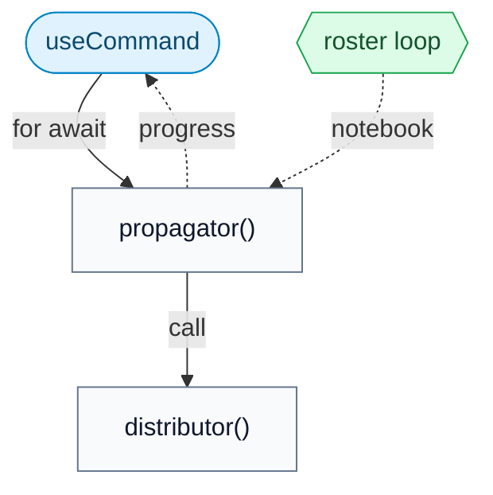
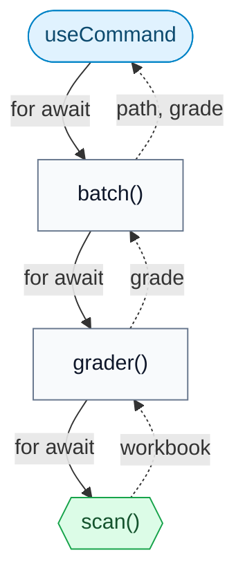
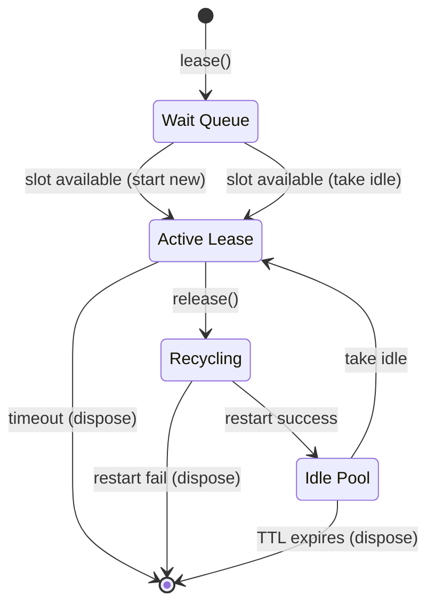

# Correxit design principles

This document describes the architectural decisions, data flow, and technical
principles of Correxit. It is written for anyone reading or working on the
codebase.

## Security

Correxit workbooks are Jupyter notebooks (`.ipynb` files) with rubric data in
their metadata. Because these files are shared between authors and students,
integrity is paramount. Correxit only writes locked rubric contents to the
notebook metadata.

An author _can_ save a workbook while it is unlocked. Reference cells will
remain decrypted and readable, but the rubric itself stays locked and secure.
It is the author's responsibility to lock a workbook before distributing it.

Cryptographic keys are never serialized to notebook metadata or assignment
files. They enter via user input or the configured `Unlocker`; the shipped
secrets-manager connector is in-memory, while deployments may intentionally
provide different key custody.

Correxit uses `openpgp.js` for symmetric encryption/decryption and PGP
Curve25519 asymmetric encryption (sealed submissions), and native
`window.crypto` for HMAC-SHA-256 signing and PBKDF2 key derivation. All fields
use explicit nulls (`field: Type | null`) rather than optional markers
(`field?: Type`) to ensure stable JSON serialization, which is required for
deterministic cryptographic checks. The plaintext PGP private key exists
only in local scope during `unlock` and is discarded when the function returns.

## Architecture

Correxit is entirely client-side, there is no backend. All logic runs in the
browser.

## Accessibility

Correxit is built for education. That creates an explicit obligation to be
approachable by as many people as possible. Accessibility is not polish here,
it is part of the product's integrity.

UI work must preserve durable keyboard flows, explicit labels, visible focus,
live feedback for changing state, and cues that do not rely on color alone.
Prefer native controls when they fit. When a custom interaction is necessary,
its accessible name, focus behavior, and keyboard contract must be treated as
part of the feature, not as follow-up work.

Jupyter/Lumino commands serve as the controller layer. All user interactions and
long-running operations are mediated by a small API of commands that drive
multiple UI surfaces:

- the Correxit sidebar
- the Corrector widget for batch grading
- the Reviewer widget for per-cell manual review
- cell and notebook toolbar buttons and decorations

The architecture is divided into three layers:

- **User Interface**: displays state, accepts user input, and executes
  commands. It stays declarative except for minimal `ReactWidget` glue.
  Modules: `src/ui/`, `src/corrector/`, `src/correxit/input.ts`,
  `src/correxit/use-command.ts`, `src/corrector/bridge.ts`.
- **Commands**: define permissible actions and route them into the
  business logic. They orchestrate the `Rubric` and `Workbook` APIs.
  Modules: `src/correxit/commands.ts`,
  `src/corrector/commands.ts`.
- **`Rubric` & `Workbook`**: manage mutable notebook state, immutable
  rubric operations, cryptography, file manipulation, and kernel
  communication. Modules: `src/correxit/rubric.ts`,
  `src/correxit/workbook.ts`, and related helpers.

**Principle:** _All state mutations and actions flow through commands._ UI
components are declarative. They render state and execute commands, but never
call model functions directly.

Assignment drafts keep edit, observation, save, acknowledgement, and retry
transitions together in the pure model (`src/ui/draft.ts`). The controller
(`src/ui/drafts.ts`) owns notebook subscriptions, debounce, command execution,
and disposal. `SidebarWidget` owns the controller and prepares each editor
before rendering React. React reads
the editor with `useSyncExternalStore` and submits edits; it never creates or
disposes notebook subscriptions. A cached draft follows its notebook view even
while inactive, so lock transitions can discard pending edits across tab switches.

### Assignment lifecycle

The editor reconciles edits made in one browser session through Correxit commands.
Its ownership boundaries are:

| Owner                         | State and responsibility                                                                                                     | Lifetime                                                            |
| ----------------------------- | ---------------------------------------------------------------------------------------------------------------------------- | ------------------------------------------------------------------- |
| React editor                  | Controls and presentation; derives registration selection from the draft and submits explicit edits                          | One view/context, path, and rubric identity                         |
| `SidebarWidget` / `drafts.ts` | One draft controller per visited workbook object; timer, subscriptions, current save snapshot, and retained headless context | Until owner disposal or rubric replacement; survives switching away |
| `draft.ts`                    | Pure field reconciliation: observed assignment, raw input, explicit queued fields, semantic input version, and save snapshot | Owned by the controller; reset at lock boundaries                   |
| `commands.ts`                 | Resolve the intended workbook and keep that target through asynchronous work and follow-up file saves                        | One command invocation                                              |
| `workbook.ts`                 | Optimistic rubric cache, lock generation, and latest metadata-write promise, shared by cloned views                          | One shared notebook model                                           |

The observed assignment can be ahead of persisted metadata. Raw roster text is
kept separately from its trimmed, deduplicated value. The displayed assignee is
normalized against that roster, without treating an automatic normalization as
an explicit user edit. Late policy and penalty form one field group. Clearing
a deadline explicitly clears that group, including fields already null.

Registration dropdowns read the draft identity and submit edits directly on user
selection. Registrar initialization is separate: new registrar results and unlocks
match the current draft, default to a sole registration, or clear an unavailable
choice. Observing another view's save does not reapply a prior dropdown selection.

`ready`, `saving`, and `failed` are the only draft phases. Locking and disposal
are lifetime boundaries rather than additional save phases. A lock reset may
start a new draft while an older command is still settling; save identity keeps
that older completion from acting on the new draft.

| Event                                  | Transition and rule                                                                                                                                                                                                  |
| -------------------------------------- | -------------------------------------------------------------------------------------------------------------------------------------------------------------------------------------------------------------------- |
| Open an unlocked workbook              | Create a clean `ready` draft, or observe through the existing controller for the same rubric                                                                                                                         |
| Change only roster formatting          | Keep the raw text; do not advance the semantic version or create intent                                                                                                                                              |
| Edit fields                            | Advance the semantic version and retain explicitly edited groups in `queued`, even for a return to the observed baseline; `failed` becomes `ready`                                                                   |
| Observe a workbook update              | Adopt untouched fields; preserve queued fields, fields in the pending save, and unsaved differences; observing an equal normalized roster preserves raw formatting                                                   |
| Debounce expires in `ready`            | Re-read the originating workbook; snapshot normalized differences plus queued intent, transfer that intent into `save`, clear `queued`, and enter `saving`                                                           |
| Edit while `saving`                    | Keep the current save snapshot unchanged; accumulate later edits separately, including reversions; do not start a second command for this controller                                                                 |
| Save succeeds                          | Acknowledge only its submitted patch, reconcile the latest workbook, and return to `ready`; later queued edits can start another debounce                                                                            |
| Save fails                             | Restore submitted fields to `queued`, keeping newer edits; retry if input or the full normalized patch changed, otherwise enter `failed`; later observations alone do not retry                                      |
| Observe a lock boundary                | Reset the draft and timer; an old completion cannot acknowledge a replacement save snapshot                                                                                                                          |
| Switch views                           | Keep each controller alive; display its draft registration by ID or, when absent, name; observing selection never queues an edit                                                                                     |
| Dispose an owner or replace its rubric | Cancel scheduled work, disconnect subscriptions, and release retained context identity; a command already handed off may finish on its original live document, but the disposed controller cannot schedule more work |

A save snapshot's identity prevents late completion from acting on a reset
draft. The semantic version answers whether new input arrived during a failed
attempt. The explicit queue records intent that comparing values cannot recover:
if B is being saved and the user changes back to A, A must survive even when it
equals the observed baseline. These serve different purposes and are not
interchangeable dirty flags.

The controller calls `Draft.begin` against the current assignment, submits its
save snapshot through `correxit:assign`, and passes the outcome and latest
assignment to `Draft.complete`. An old completion leaves a replacement draft
untouched. A failed draft exposes a message and Retry action; `Draft.retry`
resumes its retained intent without changing the input version. Substantive
edits can also resume a failed draft, while formatting and observation alone
cannot. The view does not own acknowledgement or retry policy.

Persistence has a separate completion rule. Every mutating method that starts
`Workbook.update()` must return or await its promise, and command callers must
propagate that completion. A matching optimistic cache value does not prove a
write succeeded. Superseded updates follow the latest write's success or
failure, and failed matching assignments can retry the metadata write. Assignment
signing rebases ordinary concurrent changes, but rejects rubric replacement or
a changed lock generation, including a lock/unlock cycle with the same rubric ID.

`Workbook.update()` returns its own audited snapshot, which may have been
superseded by the time its promise resolves. Completion follows the document's
latest metadata write, not proof that this invocation's snapshot remains current.
This contract does not serialize the read/modify/sign work that callers perform
before invoking `update`; assignment rebasing is a separate, narrower guarantee.

Metadata completion does not mean the notebook file is saved to storage.
Commands that also save the file or clear undo history do so only after the
model operation succeeds, using the already-resolved context. Explicit view or
retained context identifiers never fall back to the current tab or a fresh
context. Path-only commands retain their existing fresh-headless-context behavior.
This is not a cross-file or cross-session conflict-resolution protocol.

The regression coverage follows these boundaries:

| Contract                                                                     | Coverage                                                                                                                                                                       |
| ---------------------------------------------------------------------------- | ------------------------------------------------------------------------------------------------------------------------------------------------------------------------------ |
| Raw formatting, explicit reversions, policy groups and deadline reset intent | `src/__tests__/draft.spec.ts`; workbook roster-conflict, overdue-policy and deadline-clear matrices                                                                            |
| One current save per draft lifetime; acknowledgement and failure/retry rules | Workbook earlier-save, rejected-save and normalization-retry cases, paused at command, signing, encryption, receipt or debounce boundaries                                     |
| View identity, inactive locks and disposal                                   | Workbook clone, headless-context, lock-cycle, queued-disposal and rubric-replacement cases; command resolution/closure cases                                                   |
| Registration restoration with populated rosters                              | Workbook registration matrix: returning/staying on clones and active lock cycles, IDs and name-only registrations, queued reversions and decrypted metadata                    |
| Shared write ownership and truthful completion                               | Command superseded-intervention matrix in both completion orders; workbook matching-assignment retries; command metadata-failure cases for lock, reset, remove and dereference |
| File-save targeting and ordinary path behavior                               | Command follow-up-save matrix checks saved contents and undo-history clearing after switching tabs; view/path resolution tests                                                 |

The tests exercise controlled interleavings, not every possible event sequence.
In particular, disposal coverage cancels queued work; it does not promise to
abort cryptography already running. The lifecycle intentionally retains per-view
drafts and per-document writes: serializing one editor cannot order commands
from another view, and one document-wide draft would discard independent input.

## Data model: `Rubric` (`rubric.ts`)

The central data structure is the `Rubric`, stored in notebook metadata under
the key `correxit`. A Correxit `Workbook` is a Jupyter notebook that has a
`Rubric`, which describes how to grade and assign it.

The required `cxtformat` field identifies the persisted Correxit metadata
format independently of the Correxit package version. New workbooks use
`cxtformat: 2`, with an authenticated `contents` manifest for issued cell types,
relative order, and keyed commitments to fixed sources. Rubric cell sources
remain editable. Secret references are checked as plaintext, so encryption's
randomness does not affect their identity.

Format 1 was a draft with no usage in the wild. Format 2 supersedes it and is
the only supported format. Missing, draft, and unknown formats fail closed;
opening or scanning never migrates metadata. See [SECURITY](security.md) for
the serialization contract.

A rubric is immutable. Each mutation returns a new instance (with a new
`revised` timestamp) via functions in `rubric.ts`.

A rubric exists in one of two mutually exclusive states:

### Locked and Unlocked

1. **`Rubric.Unlocked`**: The working state. Contains the decryption `key` and
   a decrypted `assignment.roster`. Used for editing, configuring, assigning,
   and certifying.

2. **`Rubric.Locked`**: The persisted state stored in notebook metadata. The
   `key` field is `null` and the `assignment.roster` is an encrypted string.
   Used for distribution and correction.

The `locked` boolean serves as the discriminator for TypeScript narrowing.

## Data model: `Workbook` (`workbook.ts`)

`Workbook` is an abstraction over Jupyter notebooks. A `Headed` workbook
is backed by an active `NotebookPanel` visible in the UI. It exposes only
its `content` widget and document `context`. A `Headless` workbook has
only a `context` and `content: null`. It is used for batch grading and
scanning.

### Caching

`workbook.ts` uses a `WeakMap` to cache the current `Rubric` instance, avoiding
repeated decryption. `state.ts` maintains an in-memory `Map` of cell scores
with FIFO eviction, the active reviewer cursor cell, and a `refreshed` signal
that triggers sidebar re-renders when cursor or state changes.

### Active workbook

Command arguments must be serializable. Synchronous command logic (`isEnabled`,
`isVisible`) resolves the current workbook and cell via `state.workbook()` and
`state.cell()`. Async `execute` functions use `reify()` to resolve a workbook
by checking state and/or fetching when appropriate. Draft saves identify their
originating view or a headless context retained for the draft's lifetime;
expired identifiers never fall back to another workbook. Path-only commands
continue to fetch a fresh headless context.

Use `Workbook.open()` to retrieve the current rubric.

## Discriminated unions

Correxit uses TypeScript discriminated unions to encode mutually exclusive
states, enabling the compiler to enforce correctness:

- **`Rubric.Locked | Rubric.Unlocked`**: discriminated by `locked`.
- **`Headed | Headless`**: discriminated by `content`.
- **`Reified`** (in `commands.ts`): encodes three possible states when
  resolving a workbook from command arguments. After `if (!rubric) return`,
  TypeScript knows `workbook` is non-null.

This eliminates classes of runtime errors by making invalid states
unrepresentable.

`Workbook.Grade` also discriminates command results with `verified: true |
false`. Only authenticated grading or collection produces verified scores;
`Workbook.Certified` requires that provenance. The flag lives in memory, not in
notebook metadata. Scanning and parsing cannot manufacture it. Batch cache
reuse follows authentication inside the same bounded grading action, and CSV
exports consume verified results instead of falling back to scanned reports.

## Asynchronous patterns

Long-running operations (propagation, grading, scanning) are implemented as
cold `async function*` generators. They do no work until iterated. Each `yield`
suspends execution until the caller pulls the next value, providing automatic
backpressure.

### Generator pipelines

Each pipeline is a pull-driven chain of generators. Nothing moves until asked.

**Assignment propagation:** the propagator defines the roster loop, creates the
local notebooks unconditionally, and optionally calls a distributor leaf
function per assignee:

**Batch grading:** the batch command iterates a grader, which iterates scanned
workbooks. Each graded workbook is automatically certified when all cells are
resolved. Collection is a separate step invoked per-workbook after
certification:

Every pipeline is pull-driven and cold. The one intentionally _hot_ async
iterable is the `Monitor` plugin, which emits workbook changes as the user
switches tabs. It is backed by a Lumino `Stream`.

### `useCommand` (`use-command.ts`)

`useCommand` bridges async generators and React. It executes a command, iterates
its output via `for await`, buffers results, and flushes to component state at
~60fps via a `Throttler`. It handles cleanup on unmount.

### Reviewer bridge (`bridge.ts`)

The Corrector and Reviewer are separate widgets that share state: the Corrector
owns the list of scanned workbooks and collated grades, while the Reviewer owns
the navigation cursor. `bridge.ts` is a lightweight `useSyncExternalStore`-based
external store that lets the Corrector `publish()` workbook/grade snapshots and
the Reviewer `navigate()` to a cursor position. The Reviewer subscribes via
`useSnapshot()`. This avoids coupling the two widgets through props or context.

## Kernel pool concurrency model

The kernel pool (`kernels.ts`) manages bounded concurrency for batch
grading. It uses a semaphore-like `acquire()` mechanism to limit active
and recycling kernels. Released kernels are restarted and cached with a
time-to-live (TTL) to avoid the cost of starting fresh kernels for later
workbooks.

## Style

Correxit is built with functions, namespaces, and pure data. Classes appear only
where Jupyter APIs require them (e.g., `ReactWidget` wrappers). React's
functional components and hooks fit naturally.

Logic is expression-oriented: `map`, `filter`, `find`, `Object.fromEntries`
rather than imperative loops or `reduce` with spread.

Names should be single, distinct English words drawn from the domain:
`propagate`, `certify`, `lease`, `inject`, `reify`. In the core codebase,
pattern words like `producer`, `handler`, `manager` are avoided, though plugin
authors are free to use whatever idioms match their environment. Compound
identifiers are acceptable when convention demands it (e.g., `useCommand`,
`setState`) but the core default is brevity.

## Plugins

Correxit provides extension points as JupyterLab plugins, each identified by a
single token. Core logic is decoupled from IO, e.g. replacing a distributor
implementation requires no changes to the propagator loop or commands.

- **`Distributor`**: delivers one propagated workbook. Default: manual
  no-op.
- **`Collector`**: collects certified grades. Default: digest receipt.
- **`Registrar`**: provides assignment registrations. Default: `null`
  for manual entry.
- **`Submitter`**: handles submission receipts. Default: digest receipt.
- **`Unlocker`**: acquires credentials for creation, submission, revision, and
  recovery; stores author keys and unlocks rubrics. Default: passphrase prompts
  and in-memory `SecretsManager`. Hosted providers can supply keys directly.
- **`Monitor`**: yields the active workbook as the user switches tabs.
  Default: `Stream`-based async iterable.

Type definitions are in `src/correxit/correxit.ts`. Default implementations are
in `src/plugins.tsx`. See [PLUGINS.md](plugins.md) for the full integration
API.

## Design philosophy

Correxit is dense by design. Files are self-contained, and functions say
exactly what they do with the fewest tokens necessary. A function carries
significant meaning per line, but remains independently readable. The goal is
to let you understand a module without holding the rest of the system in your
head.

Some guiding principles:

- **Say the most with the fewest words.** Every name, every line, every
  structural choice should earn its place. If something can be removed without
  loss, remove it.
- **Vocabulary discipline.** Each word in the codebase has exactly one meaning.
  `workbook`, `rubric`, `grade`, `cell`, `lease`: these are domain terms with
  stable definitions. Naming is load-bearing.
- **Pull over push.** Async generators compose via `yield*` delegation. The
  caller controls the pace. This is simpler and more composable than signal
  graphs or event emitters.
- **Framework seams.** Correxit integrates with JupyterLab's core primitives
  (commands, widget lifecycle, plugin tokens) while adopting functional
  patterns (generators, pure data structs, external stores) for state and
  data flow.
- **Readable reliability.** Security hardening should not obscure the
  lifecycle. A future contributor should be able to audit intentional lines in
  order: terms, MAC, validation; unlock, verify, unseal; scan, authenticate,
  grade or collect. Brevity and readability are part of Correxit's reliability
  posture.
